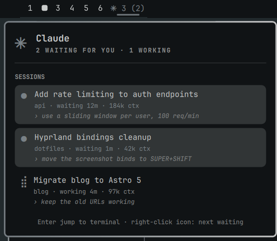

# Claude Sessions for Omarchy

An [Omarchy](https://omarchy.org) shell bar widget that shows your live
[Claude Code](https://claude.com/claude-code) sessions: which ones are working, which are waiting for you, and one
click to jump straight to the terminal a session is running in.



## What it does

- **Bar icon.** A spinner while every session is working, a steady icon (in your theme's accent colour) as soon as
  one is waiting for input, and a count: `3 (1)` means three sessions, one waiting.
- **Popup.** Each session with its title, project, how long it has been working or waiting, the last prompt you
  sent and how big its context is. Sessions waiting for you are listed first, longest wait on top.
- **Jump to it.** Click a session (or pick one with the arrow keys and press Enter) and Hyprland focuses the
  terminal window that hosts it. Right-clicking the bar icon jumps to the session that has waited longest.
- **Stays out of the way.** With *Only show when there is something to show* on (the default) the icon takes no
  bar space while no Claude Code session is running.

Colours come from the active Omarchy theme, so the widget follows `omarchy theme set`.

## Requirements

- Omarchy 4 (omarchy-shell) on Hyprland
- `python3` (standard library only)
- Claude Code

## Install

```bash
omarchy plugin add https://github.com/Edward-Kulyk/omarchy-claude-sessions.git --enable
```

Update later with `omarchy plugin update edward-kulyk.claude-sessions`, remove with
`omarchy plugin remove edward-kulyk.claude-sessions`.

## Settings

Change them in the shell settings panel, or in the widget's entry in `~/.config/omarchy/shell.json`.

| Key | Default | Meaning |
| --- | --- | --- |
| `contextual` | `true` | Hide the icon while no Claude Code session is running |
| `pollMs` | `1500` | How often session files are re-read, in milliseconds |

## IPC

```bash
omarchy-shell edward-kulyk.claude-sessions toggle        # also: open, close
omarchy-shell edward-kulyk.claude-sessions status        # one line per session
omarchy-shell edward-kulyk.claude-sessions focusWaiting  # jump to the longest-waiting session
```

Bind `toggle` to a key in `~/.config/hypr/bindings.lua` if you prefer the keyboard.

## How it works

Claude Code keeps a small registry file for every running session in `~/.claude/sessions/<pid>.json`. The
widget's helper, `claude_sessions.py`, reads those files, drops sessions whose process is gone, and takes the title,
last prompt and context size from the tail of each session's transcript in `~/.claude/projects/`. Nothing leaves
your machine and nothing is written except a small title cache in `~/.cache/omarchy-claude-sessions/`.

To find a session's window it walks up the process tree from the Claude Code PID until it reaches a PID that
`hyprctl clients` knows, then focuses that window.

> **Note:** the session registry is an internal Claude Code file, not a documented API. If a Claude Code update
> changes its format the widget may show nothing until it is updated; please open an issue.

## Development

```bash
node --test tests/                          # Model.js
python3 -m unittest discover -s tests       # claude_sessions.py
uvx ruff check . && uvx ruff format --check .
```

Clone into `~/.config/omarchy/plugins/edward-kulyk.claude-sessions/` and the shell reloads it on every save.

## License

[MIT](LICENSE)
